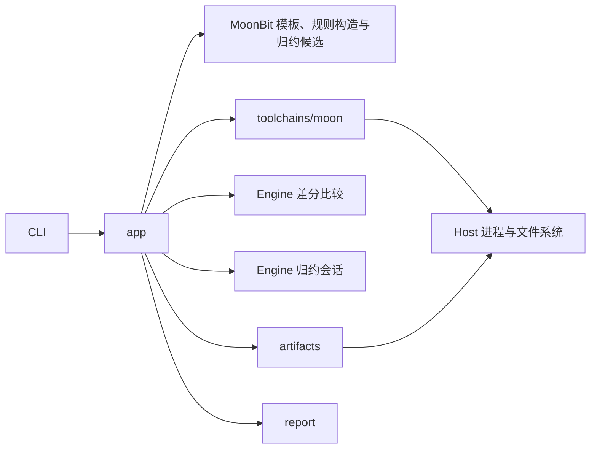

# 贡献指南

## 开发准备

先保证本机 `moon` 已在 `PATH` 中，官方安装目录为 `~/.moon/bin`。然后在仓库根目录运行
`just install` 初始化 MoonBit 包索引，并把 `prek` 的 `pre-commit` 和
`commit-msg` hooks 装进本仓库 `.git/hooks/`。依赖包会在首次检查或构建时下载。
检查工具配置见 [prek.toml](prek.toml) 和 [CI 工作流](.github/workflows/ci-static-checks.yml)。

## 常用命令

| 命令 | 作用 |
| --- | --- |
| `just` | 列出开发命令 |
| `just install` | 初始化或刷新 MoonBit 包索引并安装 Git hooks |
| `just format` | 格式化 justfile 和 MoonBit 包 |
| `uvx prek run --all-files` | 统一运行仓库静态检查 |
| `just build` | 构建 workspace 全部模块及 native 可执行入口 |
| `just test` | 运行单元测试及真实 MoonBit 工具链集成测试 |
| `moon run modules/cli/src/cmd/moonsmith --target native --deny-warn -- run` | 生成一个案例，执行三种编译配置并保存结果 |

新增文件需纳入 Git 索引后才能被 `--all-files` 检查。尚不准备暂存内容时可使用
`git add --intent-to-add <文件>`；单独检查未跟踪文件也可运行
`uvx prek run --files <文件>`。

文档变更运行 `uvx prek run --all-files`。实现变更还需运行 `just build` 与 `just test`，
并增加或运行相关行为测试。入口变更还需通过表中的 `moon run` 命令验证实际入口。进程生命周期、判定和
归约必须覆盖其实际失败边界，不能只断言内部调用。
未来的编译器测试矩阵与 MoonSmith 自身的构建检查分别记录；当前 CI 的 native 检查不代表
四后端、五配置验证已经完成。

## 质量检查

检查规则、工具版本与适用文件统一维护在 [prek.toml](prek.toml)。prek 执行源码格式与类型、
模块依赖、配置与文档、链接、工作流、凭据及提案校验。按检查结果修正问题后，重新运行同一入口。

`just check` 是 `uvx prek run --all-files` 的快捷入口，CI 也通过它执行相同门禁。
提交消息由已安装的 `commit-msg` hook 检查；PR 标题与正文由 CI 检查。

## 模块与包边界

根目录的 [moon.work](moon.work) 组织四个独立模块。模块、包及角色的定义见
[术语索引](docs/glossary.md#提案与模块边界)，完整成员清单和允许依赖见
[FP-0001](fps/FP-0001-workspace-modules.md#包的职责与依赖)。变更边界时更新该提案，
执行流程更新本文的[原型执行契约](#原型执行契约)，具体 API 更新所属模块 README。

四个模块的 `0.0.0` 都是初始占位版本，尚未发布；后续分别管理版本，无需同步升级。
`moon.mod` 使用带版本的依赖声明，workspace 内按成员名解析到本地源码。成员版本变化后
运行 `moon work sync` 更新依赖方声明。`moon.pkg` 的 import 声明实际调用的包，
模块版本依赖与包导入分别维护。

[.alint.yml](.alint.yml) 检查 workspace 布局、模块与包清单、当前组件之间的依赖方向，并阻止
纯计算组件直接导入已列出的环境与 I/O 依赖。import 检查覆盖 `moon.mod` 与 `moon.pkg`，
依赖 `moon fmt` 规范化的格式；新增模块、包或依赖时同步核对规则。
这些规则纳入统一的 prek 门禁。各包的行为测试放在相应包内，优先通过公共接口测试。

变更工作区布局、模块依赖或打包规则时，在临时副本中按 [FP-0001](fps/FP-0001-workspace-modules.md)
进行专项验收：验证违规结构和导入会被 alint 拒绝，提供方变更能传播到消费方，
`moon work sync` 更新依赖声明而不联动提升消费方版本，以及各模块能独立打包且包含所需文件。
这组验收按变更范围执行并保留证据，不纳入日常 `just test`。

## 差分测试库路径

[FP-0002](fps/FP-0002-moonbit-semantic-contract.md) 的路径由 `app.run_differential` 装配：
选择种子 → 自动组合模板 → 按规则补全并检查 → 三配置执行 → Engine 差分比较 → 存证。
`cmd/moonsmith` 负责参数、帮助、输出和退出码，只调用 app 与 Host。
语言规则和观察协议由适配器维护，Engine 判断证据，report 只渲染传入数据。



## 原型执行契约

当前命令行按 [FP-0003](fps/FP-0003-cli-workflows.md) 执行单个差分案例；无参数只显示帮助，
`run` 启动测试。应用层默认从系统熵选择种子，`--seed` 接受有符号 32 位整数；非法值和缺失值
在启动前报错。算法始终取得显式种子，实际值同时显示并保存，生成失败也保留已选种子。

程序覆盖绑定与引用、分支、无环函数定义与调用，以及支撑它们的 Int/Bool 表达式。
Int 加减采用 MoonBit 的 32 位环绕语义；源码自带输入，不读取参数或外部状态，不需要参考值。
模板与补全共享节点、深度和构造次数预算，默认值及范围由 [MoonBit 模块](modules/moonbit/README.md)
维护。生成预算和执行超时可在库 API 中覆盖，非法值在执行前拒绝，构造次数耗尽明确结束。
产品配置入口与公开范围仍留待后续 PR，不因库参数存在就逐项添加 CLI 选项。

计划配置固定为 native debug、native release、wasm-gc debug，执行前显示并完整保存。
每个配置先构建再执行，默认编译 30 秒、运行 2 秒，每个输出流上限 64 KiB。
一个配置失败或发现分歧后继续其余配置。Host 通过 `moonbitlang/async@0.22.4` 收集输出、
回收直接子进程；进程树隔离与后代清理尚未实现，不作为任意不可信程序的沙箱。

所有计划配置正常执行、满足同一单值行协议且结果相同，才是 `Consistent`；两个有效结果
不同即为 `Difference`，其他配置失败不能掩盖差异；其余为 `Incomplete`。编译错误、崩溃、
超时、输出超限和非规范输出保留原始事实，不作为结果值。一致不证明正确，差异不自动定位错误配置。

正常终端输出保持简短；分歧或执行失败时展开各配置的有效结果或失败阶段与原因。
摘要包含种子、计划配置、有效结果数、案例及本次尝试位置。保存成功时，一致返回 `0`、
分歧返回 `2`、比较未完成返回 `3`；参数、生成、保存等操作失败返回 `1`。
已经发现分歧但保存失败时，两者同时报告，不声称材料已完整保存；帮助正常显示返回 `0`。

`runs/` 下的版本 2 案例保存生成记录、实际源码、构建文件、观察协议、计划配置及有效预算。
`replay CASE_DIR` 使用这些材料在当前工具链上执行，不重新生成程序，也不要求恢复原工具链。
已知版本变化会提示；探测失败保留原始事实并说明版本未知，不声称版本相同。
每次尝试独立保存 `moon version --all`、`uname -srm`、实际命令、状态、原始输出和比较结论。
stdout/stderr 按 UTF-8 文本记录，无效编码使用替换字符。

原始文件和旧尝试不覆盖；新尝试中的 `report.md` 与 `attempt.json` 独占创建，后者最后写入
作为完成标记，缺少它表示未完成。无效命令、参数或不支持的记录格式在执行前报错。
故障注入用于内部验证，保留原始输出并明确标识。

`run` 保存原始分歧后自动归约。语言适配器提供结构缩减和 Int 常量归零两项操作，
产生完整检查通过、结果类型不变且成本更低的候选。成本按节点数、整数常量绝对值之和、
源码 UTF-8 字节数字典序比较，节点数相同仍可改善。
Engine 依次枚举各操作，接受后从新程序重新开始固定操作顺序，共享同一会话与预算。
Engine 固定首次分歧的配置对；候选自己的两个有效输出仍不同时才接受。另一对配置出现分歧、
编译失败、崩溃、超时或非规范输出不能代替原判据。其余配置仍全部执行并保存。
候选预算默认为 16，库 API 的 `reduction_limit` 允许 `0..64`，CLI 使用默认值；原始执行和
结束后的一次独立确认不计入候选数。零预算仍确认原例，不声称有缩减进展。

原始 `attempt.json` 先保存，候选和确认分别追加尝试。原始尝试目录的 `reduction.json`
以独立的版本 2 摘要记录配置对、预算、尝试与接受数、成本定义及前后值、最佳结果、停止原因
及确认状态；原案例和尝试的版本保持不变。未写成时不声明归约完整交付。
只有独立确认仍保持原配置对分歧时才展示已确认产物；不保持或证据不足均明确标为未确认。
归约操作或保存失败返回 `1`，保留并展示原始比较结论；确认不保持时仍保留原始分歧的 `2`。
归约搜索结束不保证局部或全局最小，单次确认也不代表统计稳定性。

`replay` 同时接受案例目录和该案例下的已完成尝试目录。后者检查 `attempt.json` 与
`main.mbt`、构建文件和案例协议是否一致，重跑保存的候选源码；仍向原案例追加记录，不恢复搜索。
因此归约结果不依赖重新生成 AST 或保存时的生成器。原始版本 2 案例及尝试格式不变。
参考求值仍是独立库能力。API 与限制见 [MoonBit](modules/moonbit/README.md) 和
[Engine](modules/engine/README.md)。
差分闭环测试覆盖生成与预算、判定、实际工具链执行、保存失败、重放追加和 CLI 结果；
不将故障注入当作编译器缺陷，也不将当前两个后端、三配置验收等同于完整比赛矩阵。

## 提交与 PR

提交及 PR 标题使用英文，保留 ZenDev 的 emoji 和类型配对，例如：

```text
🎉 init: bootstrap MoonSmith repository
📝 docs(architecture): define the compiler validation pipeline
✨ feat(generator): generate bounded boolean expressions
🐛 fix(reducer): preserve the failure predicate
```

PR 正文使用[模板](.github/pull_request_template.md)，必填章节为“动机”和“解决方案”。
正文面向不了解会话背景的评审者，聚焦本 PR 相对 base 的改动：解决的问题、最终设计或
行为及必要影响。省略操作流水、协作过程、其他 PR 的工作总结和与本次改动无关的能力说明。
不要在 PR 正文罗列本地测试情况、测试命令、机器路径、通过清单或 CI 状态。
“影响与边界”为可选章节，仅补充影响评审或使用的兼容性、迁移要求、已知限制或关键取舍，
不重复解决方案；没有相关内容就省略，不填写“无”。实际检查仍按本文执行。
所有 PR 都检查标题；依赖更新机器人仅豁免正文模板。机器校验格式，英文表述由提交者及
评审者核对。

## 设计与证据

只有已有设计未覆盖、且有明确大影响面的新决定才使用 [FP](fps/README.md)，门槛见
[FP-0000](fps/FP-0000-governance.md#何时需要-fp)。文档纠错、恢复预期行为的意外 bug 修复、
普通兼容增强和既定设计的实现无需新提案；原 bug 严重或改动量大本身不是提案理由。
提案记录取舍，`status` 表示提案当前所处阶段；[ROADMAP.md](ROADMAP.md)维护未来目标、
依赖和推进条件。架构维护整体设计，实现 PR 关联对应文档并说明最终行为及必要影响。
内部调研、方案比较与决策依据归入[工程笔记](.agents/notes/README.md)，公开契约仍在对应文档维护。

提案规则配置在 [zendev.toml](zendev.toml)，正文引用必须直接声明依赖，且只能依赖编号更早的 FP。
提案变更按[维护说明](fps/README.md#新建提案)更新生成的 `fps-index.json`，再运行统一的
prek 门禁。索引不手工维护，FP 校验已纳入本地与 CI 的相同配置。
跨文档概念按 [FP-0000](fps/FP-0000-governance.md#术语定义与引用)登记到所属提案，
更新[术语索引](docs/glossary.md)并让其他文档链接该定义；不要把具体类型或算法选择写成概念的统一要求。

架构和实现按同一个小切片更新。产品方向改变时，在 [EVOLUTION.md](EVOLUTION.md)
记录已经发生的变化及其日期、触发和理由，并同步修订路线图中的未来安排。
文档分工见 [FP-0000](fps/FP-0000-governance.md#文档分工)。比赛范围与验收目标维护在[申报书](docs/project-proposal.md)中，
实测结果另附工具链、环境与原始记录。

固定回归案例纳入版本控制；批次实验产物放在忽略的 `runs/`。引用公开缺陷、历史项目或
第三方代码时保留来源及许可证说明。记录 AI 辅助的范围，人工核验涉及语义和实验的结论。

固定输入维护在 [`cases/`](cases/README.md)，每例保留必要的 `case.toml`，
仅在需要时增加源码或观察数据。[Corpus 清单](corpora/README.md)引用共享 case 并声明
所验证的结论、执行入口与证据种类，`pending` 定义不计作已执行的产品验收。
测试装配留在 CLI 的 app 包，按所有清单中的 `runner` 选择案例，不依赖分类名称或数量；
同一案例与入口的重复引用只执行一次，入口没有案例时明确报错。历史参考案例复用工具链
执行与 Engine 判定，源码不加入 workspace。目录和引用检查独立于行为验收。
`just test` 执行当前工具链的案例检查，并向 `runs/` 追加证据。受影响旧版的真实复现单独记录
环境与原始结果，不能用当前版本通过检查代替。
