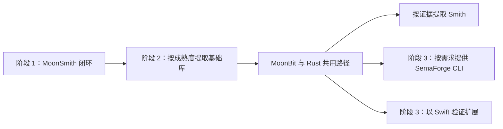

# 路线图

更新日期：2026 年 10 月 11 日。

MoonSmith 面向 MoonBit 提供程序生成、编译器测试和失败案例处理能力。长期计划是从实际
跨语言需求中逐步提取 SemaForge 公共库，再提供通用产品入口；MoonSmith 持续承担 MoonBit 专用体验。

本文连接近期工作与长期方向，按能力介绍计划，并保留三阶段的推进条件。阶段依赖决定
哪些工作需要先取得证据，各能力的迭代可以交错进行；不以日期触发更名、迁移或发布。

## 当前状态

这里只列出已有原型、当前设计和下一步重点。已有原型表示在注明范围内存在实现，
不代表完整语言支持或产品发布；设计中的能力需要实现和验收后才进入已有范围。

| 状态 | 能力 | 当前范围与依据 |
| --- | --- | --- |
| 已有原型 | 受限 MoonBit 程序生成 | 固定种子、整数与布尔表达式、顺序局部绑定和分支；见 [MoonBit 模块](modules/moonbit/README.md) |
| 已有原型 | 参考结果与多配置执行 | 参考求值，native debug、native release、wasm-gc debug 三配置执行与校验；见[原型执行契约](CONTRIBUTING.md#原型执行契约) |
| 已有原型 | 基础归约、存储与重放 | 有预算的归约、原始案例保留及追加式执行记录；见 [Engine](modules/engine/README.md) 与 [CLI](modules/cli/README.md) |
| 设计中 | 模板生成与差分测试最小闭环 | 规则组合模板、受约束补全、独立于参考值的差分比较、CLI 预算与存证；见 [FP-0002](fps/FP-0002-moonbit-semantic-contract.md) |
| 设计中 | MoonSmith 命令行工作流 | 已选择完整流程优先、首版一次处理一个案例，继续讨论命令入口、预算参数、结果呈现与旧入口迁移；见 [FP-0003](fps/FP-0003-cli-workflows.md) |
| 下一步 | 实现并验证首轮闭环 | 用绑定、分支和函数调用的组合案例取得真实执行证据，验证默认预算与 CLI 覆盖，以及保存后再次执行 |

下面的勾选项表示已有的具体能力，未勾选项表示尚待完成的目标。清单顺序不构成完整排期，
长期方向也不自动进入下一轮实现。

## 三阶段方向

| 阶段 | 产品与能力目标 | 推进条件 |
| --- | --- | --- |
| 1. 稳定 MoonSmith | 完成 MoonBit 专用产品闭环，验证生成、执行、比较和证据路径 | 以真实工具链运行及可重现案例验证能力；当前重点是 FP-0002 的最小闭环 |
| 2. 验证多语言公共库 | 启动 Rust，以第二语言验证 Contracts、Engine 和语言适配边界，按证据提取公共生成机制 | 每项库提取通过隔离与行为回归；MoonBit 与 Rust 实际共用执行和证据路径 |
| 3. 形成通用产品 | 按需求提供 SemaForge CLI，并用 Swift 验证第三语言扩展 | 通用 CLI 需要双语言闭环、Rust benchmark 和实际使用需求；Swift 需要稳定的双语言基础 |

三个阶段描述产品演进，当前状态描述各项能力的成熟度，两者独立记录。进入后续阶段不要求
前一阶段所有扩展项都完成；具体门槛见各能力说明。MoonSmith 产品在后续阶段继续维护。

Smith 提取、通用 CLI 和 Swift 分别验收。通用 CLI 不等待 Smith 或 Swift，
没有值得共享的生成机制时也可以继续维护各语言生成器。

## 程序生成

### MoonBit 结构与模板

让生成器既能安排值得测试的结构组合，又能在类型与作用域约束下变化局部内容。
首轮聚焦绑定、分支和函数调用，具体模型与保证由 [FP-0002](fps/FP-0002-moonbit-semantic-contract.md)定义。

- [x] 受限表达式生成：从显式种子生成确定性的程序与源码。
- [ ] 模板组合：自动组合关键结构，保留需要测试的嵌套和引用关系。
- [ ] 规则补全：模板与普通生成共享类型、作用域及规模规则，形成无空洞的完整程序。
- [ ] 结构检查：验证新增构造中的绑定、分支及函数调用依赖，并保留编译器拒绝材料供排查。
- [ ] 生成预算：规模、深度和构造尝试次数提供默认值与 CLI 覆盖，记录实际生效值。

首轮不以完整类型目录、参考解释器或通用生成框架为前置条件。后续语言构造按可比较性
和实际测试价值扩展，每次都取得可运行案例与行为证据。

### 模板来源与反馈

先建立固定策略的可重复基线，再判断新增来源或调度策略是否提高有效探索能力。
这些能力需要各自的范围与收益依据，不扩大 FP-0002 的最小闭环。

- [ ] 自有案例提取：从自身生成的完整程序提取模板，复用程序模型和补全机制。
- [ ] 定向结构组合：针对明确的测试目标安排组合，区分静态结构与实际执行覆盖。
- [ ] 外部源码导入：在出现具体复现需求后，明确支持子集和依赖处理；源码可执行不自动意味着支持结构化归约。
- [ ] 反馈驱动样本库：在相同预算下评估调度收益，保留选择依据和原始证据。

## 差分执行

同一案例在兼容的编译配置下产生可比较的观察，分歧作为待调查证据保留。
已有原型仍使用参考输出校验；无需参考值的直接差分比较是当前设计目标。

- [x] 三配置执行：在 native debug、native release 和 wasm-gc debug 上编译并运行。
- [x] 参考校验：在当前受限子集内对照参考输出，分别记录一致、异常候选和无法判定。
- [ ] 直接差分比较：至少两个兼容配置比较同一案例；其他配置未完成时，不掩盖已经取得的结果分歧。
- [ ] 执行预算：编译与运行超时采用有界默认值和 CLI 覆盖，超时不作为正常输出参与比较。
- [ ] Host 生命周期：完善进程树隔离和后代清理，验证超时及输出限制的实际边界。
- [ ] 工具链矩阵扩展：按可用工具链和语义适用性增加配置，分别记录环境、版本和有效结果。

新构造的比较约定需要明确并验证。程序与输入的产品形式、首发矩阵细节及辅助判定能力
按实际需求设计，不由本路线图提前固定。

## 异常证据与案例处理

维护者需要能再次运行的程序、环境和原始执行记录。案例缩减与诊断建立在这些证据上，
可控故障注入、历史案例复现和新异常发现分别报告。

- [x] 原始案例保留：保存生成源码及案例信息，执行、归约和重放追加独立记录。
- [x] 基础归约：在现有子集内选择合法且更小的候选，用原 fingerprint 约束接受结果。
- [x] 案例重放：在当前支持范围内重新执行原案例，保留既有记录。
- [ ] 差分案例重执行：保存新闭环所需的输入、有效配置和原始观察，使用保存材料再次执行。
- [ ] 归约策略扩展：以候选的新执行证据验证明确的失败判据，避免用另一类失败替换原差异。
- [ ] 历史案例验证：尽早检查可获取工具链；无法复现时保留失败尝试及环境缺口。
- [ ] 实验与交付：记录生成有效性、比较完成情况、复现质量和执行成本，完善安装、回归与演示材料。

首轮闭环不等待归约扩展。实验规模和产品验收目标由[项目验收计划](docs/project-proposal.md#预期验收产物)
维护，具体结果附实际环境与证据；未发现新编译器缺陷也可以报告有效实验结果。

## 多语言与公共库

### 基础库与 Rust

第二语言用于验证公共边界。语言适配器保留各自的程序表示与语义，Engine 负责通用
编排和判定，Host 负责外部执行；职责来源见 [FP-0001](fps/FP-0001-workspace-modules.md#包的职责与依赖)。

- [ ] 基础库提取：启动第二语言工作后，分别审查 Contracts、Engine 的隔离、契约适用性和行为回归。
- [ ] 渐进迁移：达到条件的库分别迁入 SemaForge namespace；未通过验证的模块保持原位。
- [ ] Rust 适配：选择明确子集，处理所有权、借用、生命周期等语言约束，形成可运行案例。
- [ ] 双语言闭环：MoonBit 与 Rust 实际共用判定、预算、归约和证据路径，同时验证已有案例重放。
- [ ] Rust benchmark：固定版本、子集、种子和预算，对比探索能力、复现质量、归约效果与成本。

Contracts 与 Engine 不要求同时迁移。双语言闭环形成后，再完成 MoonBit 适配器向
`semaforge-moonbit` 的迁移，并形成 `semaforge-rust`；不以 namespace 变化代替复用证据。
Rust 在通用产品出现前使用库和实验入口，平台库不反向依赖 MoonSmith 的应用装配或 CLI。
方法参照见[对比项目与基准规划](.agents/notes/research/comparison-projects.md)，源码与 MIR 等不同输入层次分别评估。

### 公共生成机制 Smith

只有两个语言生成器出现稳定、可独立验证且有复用收益的共同机制时，才提取 Smith。
它负责共享生成机制，具体 AST、类型规则、语义状态和语言规则继续由各适配器拥有。

- [ ] 提取依据：从 MoonBit 与 Rust 的实际实现中识别共同机制，并验证共享收益。
- [ ] 共享实现：创建 `semaforge-smith`，由两个适配器调用；Smith 不依赖具体适配器，也不接管 Engine 的归约搜索。

没有足够依据时继续维护语言专用生成器，不提前建立通用 AST、强制生成接口或占位包。

## 产品入口与第三语言

### SemaForge 通用入口

双语言闭环、可复现的 Rust benchmark 和实际通用 CLI 需求共同触发产品化。
MoonSmith 保留 MoonBit 专用体验，两个产品复用同一应用层，避免复制编排、执行与存储流程。

按 [FP-0003](fps/FP-0003-cli-workflows.md#按产品阶段安排工作流)确认的安排，MoonSmith 阶段
以一次完成测试流程为主要入口，完整 SemaForge 阶段再提供可独立组合的阶段命令。
第二阶段的公共库提取不提前触发产品工作流切换，阶段交接协议与具体命令在通用产品设计时确定。

- [ ] 共享应用层：将已经验证的应用逻辑迁入 SemaForge 产品模块，连接 Engine、语言适配器和宿主能力。
- [ ] 通用 CLI：提供 `semaforge`，保留 `moonsmith` 专用入口；不增加 `sema` 别名。
- [ ] 产品一致性：相同语义子集、参数与环境下，两个入口对 MoonBit 使用相同执行语义。
- [ ] 发布边界：明确入口、包依赖和案例格式的兼容范围，验证声明范围内的旧案例重放。

通用 CLI 的交付不依赖 Smith 提取或 Swift 接入。浏览器演示及其他入口在有可复用能力
和明确使用场景时再推进，不因更换产品名自动启动。

### Swift 扩展验证

双语言基础稳定后，用第三语言检验已有边界的适用性。Swift 先选择受限子集，按需研究
值语义、引用、资源管理、泛型和协议等约束。

- [ ] 独立闭环：形成 Swift 程序生成、观察与判定的可运行案例。
- [ ] 三语言回归：新增适配后，MoonBit、Rust 的执行及案例重放继续通过。
- [ ] 边界评估：记录新增语言对共享接口的影响，将语言特有规则留在适配器。

这些结果证明特定子集上的扩展能力，不代表完整 Swift 支持；第三语言验收与通用 CLI 发布分别进行。

## 维护方式

完成事项须有对应范围的实现与验收依据；提案进入版本库或检查通过不自动勾选功能。
[FP](fps/README.md)保存设计及其提案状态，各模块 README 说明现有 API，
[EVOLUTION.md](EVOLUTION.md)记录实际方向变化。本路线图维护能力方向和推进条件，
不重复定义概念或维护另一份提案状态表。

表达形式参考 [Zensical Roadmap](https://zensical.org/roadmap/)的状态总览与能力分组。
三阶段的目标和依赖沿用 MoonSmith 已有规划；达到 [FP 门槛](fps/FP-0000-governance.md#何时需要-fp)的新决定
在对应提案中讨论，实现时同步行为文档与验证证据。
