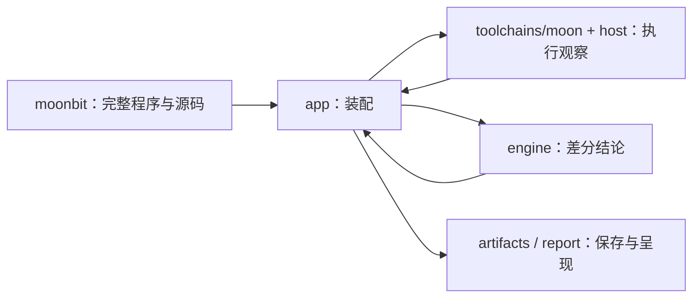

# FP-0002: MoonBit 生成与差分测试的包边界

## 摘要

本提案确定 MoonBit 程序生成与差分测试中各包的职责、交接内容和依赖边界。语言适配器
拥有程序及其语义，Engine 拥有差分判定，Host 提供执行事实，应用层连接这些能力与证据存储。
保留使这些边界成立的最小契约，具体算法、数值默认值和命令行接口由各自负责的实现或设计确定。

首版沿用已确定的方向：自动组合模板并按规则补全，以绑定、分支和函数调用形成差分测试
闭环，不要求先实现参考解释器。CLI 参数、输出形式与命令验收归
[FP-0003](FP-0003-cli-workflows.md)，不由本提案要求向用户开放内部配置。

## 动机

生成、检查、编译执行、比较和保存需要多个包协作。如果仅按流程罗列功能，容易让应用层
重复语言规则、让工具链直接判定差异，或让内部预算变成必须公开的 CLI 参数。
提案应先回答每项决定由谁负责，以及其他包可以依赖什么保证。

作者已选择差分测试、模板结合规则构造，以及绑定、分支、函数调用的首版范围。
相关调研参考了 [Csmith](https://github.com/csmith-project/csmith)、
[Xsmith](https://docs.racket-lang.org/xsmith/Xsmith_Guide.html)与
[LeJit](https://arxiv.org/abs/2403.11281)；本次修订按作者要求将提案收拢到包边界。
现有源码与申报范围用于识别迁移影响，不作为新设计必须继承的模型。

## 设计

### 提案分工

| 提案 | 负责的决定 |
| --- | --- |
| [FP-0001](FP-0001-workspace-modules.md#包的职责与依赖) | 工作区成员、包布局、允许依赖及工程检查 |
| 本提案 | 生成与差分测试中各包的责任、交接内容及必要保证 |
| [FP-0003](FP-0003-cli-workflows.md) | 用户工作流、命令、公开参数、输出与旧入口迁移 |

沿用 FP-0001 的包及允许依赖，不新增占位包或通用插件层。内部能力需要显式预算，不意味着
CLI 必须提供对应选项；默认值、公开范围和命令验收不能从包接口直接推导。

### 包的职责与交接

下表细化现有包在本轮闭环中的分工；完整依赖清单仍由 FP-0001 维护。

| 包 | 本轮拥有的责任 | 交给其他包的内容与边界 |
| --- | --- | --- |
| `moonbit` | 程序与模板模型、构造规则、合法性检查、源码输出和观察协议 | 交付完整程序、源码与输出解释能力；模型和规则由语言包维护，不放入共享契约，不执行工具链 |
| `engine` | 根据计划配置及有效观察作出差分判定 | 交付一致、不一致或比较未完成的结论；不认识 MoonBit AST，不直接执行进程或保存文件 |
| `contracts` | 表达实际跨包传递的数据 | 承载配置、预算、执行观察、判定和记录；不放语言 AST、宿主句柄或算法状态 |
| `toolchains/moon` | 工具链身份、配置与命令计划，关联编译和运行观察 | 通过 Host 执行并返回事实；不解释 MoonBit 结果值，不决定差分结论 |
| `host` | 进程、文件系统、平台访问及资源限制的执行 | 交付原始输出、退出、超时等事实；不判断程序是否合法或哪个配置正确 |
| `artifacts` | 保存原始案例，追加和读取执行记录 | 保存传入材料并返回存储位置；不重新生成程序或重算结论 |
| `report` | 根据记录生成报告 | 呈现已有事实与结论；不重新判定或修改证据 |
| `app` | 装配生成、执行、判定、保存及报告，提供实际配置与种子 | 传递程序材料与执行事实，协调保存后再执行；不重复语言规则或差分判定 |
| `cmd/moonsmith` | 参数解析、帮助、终端交互及退出码 | 调用应用入口并呈现结果；公开接口由 FP-0003 设计 |

应用层的数据流如下，箭头表示交接顺序，不增加表外依赖：

### 语言适配器的保证

MoonBit 程序是语言适配器拥有的完整程序结构，保留类型、绑定、作用域和调用关系，
可以据此输出源码。完整程序不包含尚待填充的空洞。

程序模板是保留部分结构和约束、留有空洞的未完成程序。空洞具有期望类型和所在作用域；
模板和补全过程共用程序模型、构造规则与生成预算，不把相关片段作为独立文本拼接。

静态合法性表示程序的类型、绑定和结构自洽：引用指向可见绑定，运算和调用的参数匹配，
分支满足类型规则，函数调用关系符合支持范围。未执行代码也需要满足这些要求。

首版支持局部绑定与引用、条件分支、函数定义与调用，函数调用关系无环。语言包负责
识别未填空洞、悬空引用、类型错误及不支持的结构；具体 AST、基础值和运算规则由语言实现
明确，不要求实现完整类型系统或参考执行器。源码输出应保留程序的结构与绑定含义。
编译器的接受或拒绝是独立执行观察，不能覆盖内部检查，也不能被内部检查通过所掩盖。

观察协议规定哪些执行输出构成可比较结果，以及如何判断相等。协议由语言适配器定义，
各配置使用相同约定并保留原始输出；应用层将输出解释能力交给 Engine 使用。
比较要求同一案例、相同输入和约定的环境条件；未明确跨配置行为的构造不进入默认生成范围。
输入与入口的产品形式、输出编码不在这里固定。

### 差分比较与证据

应用层提供至少两个行为约定兼容的计划配置，并关联同一案例的执行观察。具体矩阵由
工具链实现与可用环境确定；CLI 是否允许选择配置由 FP-0003 决定。
Engine 使用语言适配器提供的输出解释能力，统一作出以下判定：

- 有效结果中存在分歧，记录不一致及涉及配置；其他配置的超时或缺失不能掩盖已有分歧。
- 所有计划配置都有有效且相同的结果，记录本次一致；不据此证明编译器正确。
- 其余情况记录比较未完成；编译失败、崩溃、超时及环境错误保留为事实，不作为结果值比较。

差分不一致只表示需要调查的异常，不自动确定哪个配置有错；不同生成程序之间不要求结果相同。
本轮不引入参考值、投票定责或完整故障分类框架。

应用层汇集源码、输入与环境条件、实际配置、工具链身份和执行观察，交由存储包保存。
重执行使用保存材料，保留原案例并追加记录，不依赖原生成器仍然可用；完整归档格式及迁移机制另行设计。

### 预算与可重复性的归属

语言包接收显式种子及生成预算，模板组合和补全共用规模、深度和构造次数限制；耗尽后明确
结束，不能无界重试。相同生成器版本、种子和有效配置产生相同程序，不承诺跨版本重生成。

应用层提供有界的有效预算：生成预算交给语言包，编译与运行限制经工具链交给 Host 执行。
执行超时是独立事实，不能当作正常结果。应用层将实际生效值、种子和生成器版本一并交给
存储包记录；预算数值、默认选择及是否开放 CLI 参数不属于本提案的决定。

## 兼容性

本次修订收拢提案职责，保留已确定的生成与差分方向，不改变 FP-0001 的包布局和依赖方向。
具体 API 与记录格式调整需同步调用方及实现说明；命令兼容性由 FP-0003 处理。
已有案例和参考结论保留原意，新的差分结论来自新的执行证据，不静默改写历史记录。

循环、递归、模板提取、归约扩展、覆盖反馈和外部源码导入留待后续需要，不阻塞本轮边界落地。
出现满足 [FP 门槛](FP-0000-governance.md#何时需要-fp)的新决定时另行提案，不预建相关框架。

## 验证

验收重点是各包能否独立履责、交接后能否形成闭环，文档检查不代表实现完成：

| 边界 | 应观察到的行为 |
| --- | --- |
| 语言包 | 不调用工具链即可构造和检查绑定、分支及函数调用组合；同条件生成可重复，预算耗尽会结束，非法结构被识别 |
| Engine 与语言协议 | 用受控观察验证一致、分歧及未完成的区分；不依赖具体 AST，第三个配置未完成不掩盖已有分歧 |
| 工具链与 Host | 返回各计划配置的编译和运行事实，保留失败与原始输出，不代替 Engine 作结论 |
| 应用装配 | 直接调用应用入口，在至少两个兼容配置上完成生成、执行、比较和存证，无需参考解释器 |
| 存储与报告 | 从保存材料再次执行并追加记录；原材料与旧记录保持不变，报告忠实呈现传入证据 |
| 依赖方向 | 通过 FP-0001 的依赖检查；语言 AST 和宿主资源不泄漏到共享契约或 Engine |

受控差异应标记为测试注入，真实执行与新异常发现分别报告。命令行帮助、参数、退出码和
迁移验收归 FP-0003；不能用直接调用应用入口的结果代替 CLI 验收。
相关行为测试与真实执行证据随实现提交，文档门禁按[贡献指南](../CONTRIBUTING.md#常用命令)执行。

AI 辅助范围为资料调研与提案起草；语义与实验结论需人工核验。
