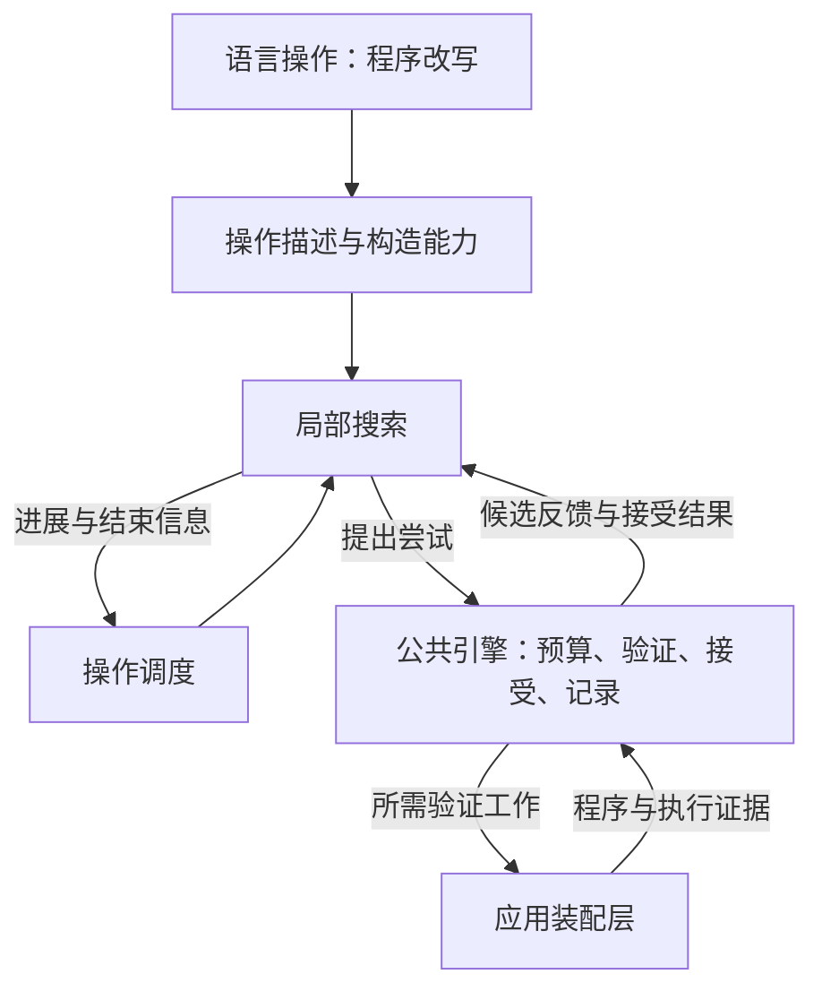

# FP-0004: Engine 的职责边界与策略扩展

## 摘要

Engine 负责测试编排、证据判定和归约搜索，语言适配器负责程序表示与语义，
应用装配层连接具体能力，Host 承担进程和文件系统。Engine 通过泛型程序值与共享契约协作，
将可替换的搜索策略与必须保持的正确性约束分开。

本提案完整约定职责、协作模型、策略边界和验收条件，设计前提仅来自已声明依赖的早期 FP。
具体算法、调度顺序、确认次数、并行度、缓存和存储机制由后续实现与实验选择；
选定的实现必须满足本提案的行为约束和验收条件。

## 动机

[FP-0001](FP-0001-workspace-modules.md)已经给出模块边界。
Engine 的后续设计需要明确责任如何协作，以及哪些变化可以独立发生。例如，更换归约搜索方法时，
不应重新实现编译器执行、失败判定或案例记录；同一案例出现多种异常时，也不应由各调用方自行
决定保留哪一项。模块依赖图本身不足以保证这些行为。

程序改写、搜索调度、候选判定和运行环境分别拥有责任，才能在替换搜索方法时复用同一套
合法性检查、执行证据和接受规则。不预建通用语言模型、动态插件或假想的能力协商体系。

## 设计

### 职责与程序表示

[Engine](FP-0001-workspace-modules.md#term-engine)、
[语言适配器](FP-0001-workspace-modules.md#term-language-adapter)、
[应用装配层](FP-0001-workspace-modules.md#term-application-layer)、
[Host](FP-0001-workspace-modules.md#term-host)和
[共享契约](FP-0001-workspace-modules.md#term-shared-contracts)沿用 FP-0001 的定义与依赖方向。
本文进一步约定它们之间的交互和归约策略边界。

应用装配层连接 Engine 与语言适配器，协调工具链、存储及报告；工具链和存储通过 Host
访问环境，跨组件数据由共享契约表达。包清单与允许依赖以 FP-0001 为准。
Engine 内部分工如下，不要求增加 package 或一一对应某种类型。

| 职责 | 拥有的决定或状态 | 边界 |
| --- | --- | --- |
| 编排 | 案例与配置的工作安排、进度、整体预算 | 不负责进程、路径或具体语言生成规则 |
| 判定 | 证据适用性、异常判断与失败判据 | 不解析原始进程输出，不实现语言求值 |
| 归约 | 搜索进度、候选评估、接受与停止 | 不修改 AST 内部结构，不覆盖原案例 |

Engine 通过泛型程序值 `P` 携带程序，不依赖或解释具体 AST。语言知识只由适配器提供，
Engine 不重建另一份类型系统。

案例（case）组织待验证的程序及其生成或来源上下文，具有稳定身份。原案例保持不变，
变换及归约产生与原件分离、关系可追溯的派生案例；程序表示、内存布局与持久化编码由实现决定。

以上是责任边界，不规定函数签名、任务枚举、会话编码或新的包结构。

### 编排与执行分离

Engine 根据显式配置、预算、随机输入和已有证据决定后续工作；应用层执行并回传事实。

工作请求（work request）描述需要完成的工作及其案例与执行上下文。请求只表达意图，
未执行的请求不能充当执行证据；它不预设任务枚举、调用接口或并发模型。

执行证据（execution evidence）描述实际发生的事情，包括取得的观察值、中断和资源限制，
并能关联到对应案例与执行上下文。派生判断说明这些事实在给定前提下支持的结论，报告不能自行补全。

应用层将证据关联到原工作上下文后回传；Engine 据此判定并决定后续工作，应用层保存案例、
实际执行和派生判断之间的关系。执行中断或保存失败必须可见，不能生成完整成功的报告。
Engine 不直接读取时钟、进程或文件系统，外部中断和资源限制作为执行事实参与后续决定。

采用何种调用接口、任务粒度或并发模型属于实现选择。实现必须说明确定性的适用条件，
配置、随机输入、预算和工具链上下文显式提供，不能让宿主随机源或未声明的执行顺序隐式决定测试输入。
输入生成的可复现性、Engine 决策的可复现性和异常的稳定性分别验证；相同种子不构成
跨生成器版本或跨执行环境的兼容承诺。

### 独立判断与失败保持

判定方法（Oracle）根据声明的适用条件解释证据，说明正在检查的性质或关系，独立保留结论。
满足、不满足、不适用和证据不足必须可区分；缺失、超时或基础设施问题不能被补成通过。
异常候选不自动等同于已确认的编译器缺陷。

案例评估（assessment）汇集各项 Oracle 的判断，同时表达异常发现和检查完整性，
不让单个报告主结论覆盖其他结果。具体结果结构及 API 由共享契约和实现文档说明。

失败判据（failure predicate）是归约需要保持的观察条件，表达有关配置、执行阶段和观察关系，
独立于展示用指纹。
候选必须具有自身有效的判据证据，不能用失效的参考值、变体或另一类失败替代目标关系。
相同判据持续成立只证明保持了该观察条件，不证明根因相同。

参考判断使用候选自己的参考结果；关系判断检查候选及其关联程序的前提和结果。候选改变后，
旧观察不能自动继续使用。失败保持要求目标关系成立，具体输出值不必保持不变。

指纹（fingerprint）按选定字段标识或分组观察到的异常，可用于展示和去重。
指纹相等本身不证明失败判据保持或缺陷根因相同；具体 Oracle 可以在明确的匹配规则中使用它。

### 分层的策略扩展

归约由以下角色协作。这些是可独立演进的责任，不要求一一对应类型、对象或 package。

语言操作（language operation）描述有意义的程序改动、适用上下文及候选构造能力，
由语言适配器提供，不判断编译器异常。

操作调度（operation scheduling）决定接下来探索哪类操作或哪个范围，
管理调度进度，不接管局部搜索的内部状态。

局部搜索（local search）在选定范围内提出尝试并利用反馈，管理自身搜索状态，
不直接执行工具链或宣布接受。

公共归约引擎（reduction engine，简称公共引擎）统一管理候选验证、预算、接受结果和证据记录，
决定候选是否可接受以及工作是否可以继续。

图中箭头表示协作中的信息流，代码依赖仍遵守 FP-0001。

| 角色 | 输入与产出关系 | 可替换的实现选择 |
| --- | --- | --- |
| 语言操作 | 程序与约束 → 可操作对象、候选及合法性结果 | 树改写、组合删除或其他语言相关方法 |
| 操作调度 | 可用操作、预算与进展 → 下一搜索范围 | 固定、分层、反馈驱动或组合调度 |
| 局部搜索 | 搜索范围与历史反馈 → 下一尝试或局部结束 | 枚举、分组、自适应或其他算法 |
| 公共引擎 | 尝试与验证证据 → 反馈、接受记录和会话结果 | 验证工作的组织与证据复用机制 |

语言操作提供搜索所需的最小信息，例如组合删除所需的元素组或单次改写的独立候选。
操作描述明确适用的程序上下文；程序变化后不能继续应用失效操作，组合改写仍须检查合法性。
不要求适配器暴露整棵 AST，也不强制全部策略使用同一种候选容器。

调度与局部搜索应能分别替换。策略使用语言操作提供的信息提出尝试，引擎回传验证和接受结果，
策略据此继续或结束局部搜索。引擎拥有整体会话的权威状态，策略拥有自身的算法状态；
策略结束不自动等于整个测试或归约会话已经完成。

搜索方法、结果度量和接受规则分别表达。具体方法可以有不同的状态、候选表示和信息需求，
无需共享某个算法的内部结构。实现按需求提供操作或反馈，不预先列出封闭的策略清单。

候选的合法性及比较资格由语言适配器确认。满足、不满足、非法与不可判定等反馈保持区别，
证据不足不能当作确定的否定。公共引擎依据这些反馈和声明的规则作出接受决定。
严格下降是一种可选接受规则；探索等规模或较大中间程序时，必须明确增长、去重和停止约束，
并受整体预算限制。原案例、当前搜索位置和最佳已知结果不能混为同一个状态。

引擎执行选定的接受规则，同时保持公共约束：原失败判据、合法性要求、整体预算和证据含义
不因策略替换而改变。策略不能自行跳过检查、修改规则或重置限额。对外报告实际结果、停止原因
与保证范围；局部无进展、预算耗尽和全局最小不能混为一谈。

### 确认、预算与证据

确认（confirmation）按声明的策略取得失败判据的稳定性证据；所需的独立复跑不能由缓存命中代替。
策略说明稳定性要求、所需独立观察及冲突处理，Engine 记录实际完成情况。
结果冲突和证据不足分别表达，不把未完成确认的候选报告为稳定结果；具体复跑次数不由本提案固定。

各策略声明资源消耗和停止条件，遵守整体预算与取消要求。切换策略不能绕过限额；
没有缩减进展、反复提出候选或预算耗尽时有界停止，保留原案例、最佳已知结果和已有证据。

原始案例、候选、验证、接受和派生判断可追溯，后续尝试追加记录；搜索状态不覆盖历史证据。
取消或执行中断时报告实际完成范围，证据保存失败时不得报告完整交付。

案例重放（case replay）依据保留的实际输入和执行上下文重新执行案例，取得新的证据。
它不隐含恢复原搜索进度，也不承诺工具链或环境变化后仍有相同结论。

搜索状态恢复（search state recovery）恢复搜索进度及继续搜索所需的状态和上下文，是独立于
案例重放的能力。本提案不要求实现某种日志协议、事务顺序或内部状态持久化。

## 兼容性

本提案扩展 FP-0001 的模块协作约定，保持其职责归属和依赖方向。Engine 不解释具体语言的
程序表示，语言语义由适配器提供，进程和文件系统由 Host 负责；这些前序约束继续成立。

策略可以在本提案的合法性、失败保持、预算和证据要求内独立替换；替换后的可观察行为
仍须满足相同契约。

满足本提案的算法替换、参数调整和内部重构属于实现演进；若改变失败保持、证据含义或模块
责任，则依 [FP-0000](FP-0000-governance.md)讨论契约变化。实现选择及实验配置另行记录，
不能在实现说明或工程笔记中增加本提案未声明的正式要求；必要的设计修订必须回到所属提案。

## 验证

后续实现通过行为验证这些边界，不能仅以接口存在或代码编译通过作为验收。

验收覆盖 Engine、共享契约，以及通过应用装配层与语言适配器、Host 之间的协作。
合成程序、受控执行事实和实际可替换的策略用于检验判断、搜索及失败边界；真实工具链执行
用于检验程序、工作请求、执行证据和判断之间的关联。各项要求按实际行为验收。

| 场景 | 应观察到的行为 |
| --- | --- |
| 独立更换调度或局部搜索实现 | 复用判定、执行与证据路径，不修改语言语义或复制一套管线 |
| 实际程序与工具链协作 | 工作请求能驱动对应程序的执行，回传证据关联到该请求与执行上下文，判定和保存结果可追溯 |
| 在声明的确定性条件下重复输入与反馈 | 得到可重现的流程决定，宿主状态不隐式参与随机选择 |
| 同一案例存在多项异常和证据缺口 | 各项结论及完整性同时保留，不用单个结论覆盖，也不补成通过 |
| 候选非法、判据失效或证据不足 | 不能成为保持原失败的接受结果，原因能够追溯 |
| 程序变化或组合改写 | 不应用失效操作，不假定单个操作合法就意味着组合仍合法 |
| 参考或关系判断 | 使用候选自己的有效证据，不复用失效的前提或观察 |
| 策略切换、无进展、反复提案或资源耗尽 | 整体预算不重置，有界停止并保留原案例、最佳已知结果和已有证据 |
| 确认结果冲突或证据不足 | 分别报告不稳定与未完成，不报告为稳定异常 |
| 取消、保存失败或执行中断 | 如实表达实际完成范围，不报告为完整交付 |
| 在相同约束下比较搜索方法 | 质量与成本由实际记录推导，结论不超出实验范围 |

案例重放与搜索状态恢复分别验收，两者不相互隐含。比较搜索方法时固定案例、失败判据、
操作空间和预算，报告结果规模、有效候选、执行成本及停止原因；不凭策略名称或上游论文性能
宣称局部或全局最小性，也不据此确定本项目的默认算法。

文档检查只验证结构与一致性；合成程序测试、Host 生命周期实验和真实编译器实验分别提供
各自范围的证据，不能相互替代。
