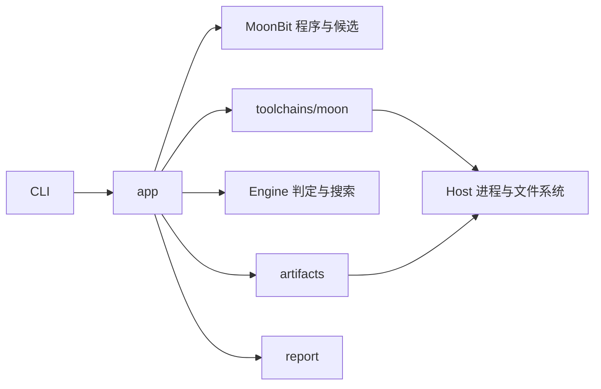

# MoonSmith CLI

通过[应用装配层](../../fps/FP-0001-workspace-modules.md#term-application-layer)连接 Engine、
MoonBit 适配器、宿主执行、案例存储和报告，提供有限差分测试任务与保存材料重执行。

开发调用方式见根目录的[使用说明](../../README.md#使用)。可执行程序无参数时只显示帮助，
`run` 启动有限任务，默认一个样本；`run --set seed_start=42` 指定起始种子，
`run --config acceptance.toml --set sample_count=10` 从文件读取并覆盖参数，
`replay <保存材料目录>` 追加一次重执行。配置字段统一通过 `--set` 覆盖，不另设专用参数。

从仓库根目录执行 `moon install ./modules/cli/src/cmd/moonsmith` 安装 native 命令，
位置与依赖要求见[安装说明](../../README.md#安装)。完整工作区提供内部模块，不要求其先发布到 registry。
安装后的二进制可以在其他目录执行，输出位置仍按任务配置的来源解释。

## 应用装配

`cmd/moonsmith` 拥有参数解析、帮助、终端输出与退出码，只依赖 app 与 Host。
`app` 装配生成、执行、比较与保存；`toolchains/moon` 定义执行矩阵；`host` 封装进程和文件系统；
`artifacts` 维护原案例与追加记录；`report` 只渲染传入数据。支持 macOS 与 Linux native 宿主。



app 包的行为测试直接发现[固定案例](../../cases/README.md)，按 `case.toml` 中的 `kind`
选择适用输入，无需外层清单。未知种类、缺失材料及必需案例集为空时明确失败。
历史参考案例复制源码后复用工具链执行和 Engine 的明确预期判定，在 `runs/` 保存独立记录。
归约案例先核对生成快照，再接入现有受控注入、确认与重放；原输入保持不变。
生成性质、模型观察、重放和超时场景在相应模块行为测试中检查。固定差分候选尚需对应工具链与
观察协议，材料可读不等于该目标已验收。批量任务的参数与运行材料见下文的任务配置说明。

## 差分执行与存证

`app.run_differential(seed?, generator?, ...)` 接通模板生成、多配置执行、Engine 比较和版本 2 存证。
默认使用 `template-rules-v2`，记录 `GeneratedProgram` 返回的实际生成器版本；
库调用可选择保留的标量版本，固定归约案例按元数据中的原版本生成并核对快照。
省略种子时从系统熵选择 Int 值；显式种子优先，熵不可用时报告错误，不回退到固定种子。
生成器取得显式值，案例与失败报告保留该值。库调用可指定生成预算与执行超时。
默认三配置全部尝试，库参数 `planned` 允许从下表选择至少两个不同配置并保留顺序；
分歧不会提前终止执行，失败成员保留在计划及观察中。

| 配置 | 构建目标与模式 | 执行器 | 默认启用 |
| --- | --- | --- | --- |
| `native-debug` | native debug | 生成的可执行文件 | 是 |
| `native-release` | native release | 生成的可执行文件 | 是 |
| `wasm-gc-debug` | wasm-gc debug | `moonrun` | 是 |
| `wasm-debug` | wasm debug | `moonrun` | 否 |
| `js-debug` | js debug | `node` | 否 |

JS 配置需要宿主已安装 Node.js。执行器缺失作为 Host 错误保存，不产生可比较结果，
其余配置继续执行。配置顺序不依赖工具链探测结果，不自动替换或跳过计划成员。

原始分歧保存后自动归约：`CompleteProgram` 提供结构缩减和 Int 常量归零两项操作，Engine 的
`Reducer` 按固定顺序枚举，接受后从新程序重新开始，保持首次分歧的配置对。
候选与确认必须使用各自的新执行证据；另一对配置的分歧、编译拒绝、超时或非规范输出
不能替代原判据。
候选按节点数、整数常量绝对值之和、源码 UTF-8 字节数的字典序严格改善。
`reduction_limit` 默认 16、允许 `0..64`，只计提交给会话的候选；
搜索结束后另做一次独立确认。每次执行均使用新目录并保存原始观察，归约结果和预算写入
原始尝试目录的版本 3 `reduction.json`，同时保存成本标识、前后成本及搜索与独立确认的耗时。
计时从搜索会话创建前开始，到确认处理或操作错误结束为止，包含候选与确认的存证，
不包含原始执行、归约摘要保存和后续重放；Host 使用 macOS、Linux 的 `CLOCK_MONOTONIC`。
摘要按完整成本判断是否改善，节点数相同的 Int 简化也能展示已确认产物。
摘要还显示节点移除比例与耗时；不同成本分量的改善不合并为一个百分数。
确认失败或证据不足时标为未确认，不展示为已确认的缩减结果。
只处理有效输出分歧，不把比较未完成当作可归约的输出差异，也不保证最小性。

工具链库提供 `native_constructor_assessment` 和 `native_constructor_predicate`，使用
`moonbit-native-undeclared-constructor/1` 识别 native release 的未声明构造器变量诊断，
覆盖 Clang 的 `use of undeclared identifier` 和 GCC 的 `undeclared (first use in this function)`。
目标要求退出 255、至少一条错误且所有错误均属于该模式，同时 native debug 与 wasm-gc debug
构建和执行成功，输出均等于调用方提供的当前候选控制输出。缺失、重复或截断证据为不确定，其他错误和
失败的控制组不能保持目标；注入输出不参与该 Oracle。此库判据尚未接入自动归约入口。

版本 2 案例保存原始源码、构建文件、观察协议、计划配置及有效预算。
`app.replay_differential` 读取保存的源码、`moon.mod`、`moon.pkg`、配置及观察协议，复制到
新的尝试目录执行，不重生成程序。不支持的格式、协议或配置在执行前拒绝。
原案例与已完成尝试不覆盖；尝试保存工具链、平台及原始观察，新的 `attempt.json`
最后独占写入，标志本次证据保存完成。
使用外部运行时的尝试另外保存版本 1 `runtimes.json`，记录 `moonrun --version` 和
`node --version` 的原始命令、状态与输出；同一运行时只探测一次。
运行时记录和报告保存后才写入 `attempt.json`，保存失败不能标为完整证据。
重放使用当前工具链和运行时；原执行的版本已知且发生变化时，终端摘要和报告提示运行时变化。
版本探测失败保留原始状态与输出，标明版本未知；旧尝试缺少运行时记录仍可重放，
但不能比较该版本。已保存的运行时记录格式不支持或身份重复时，在创建新尝试前拒绝。
重放也接受案例下的已完成尝试目录，核对保存的源码与构建文件后执行该候选，向原案例追加记录。
这是重放缩减结果的入口；它不重新归约、不重生成程序，也不恢复搜索进度。

两种入口返回 `DifferentialRun`，包含案例与尝试记录、各自目录、当前与原运行时探测、
原工具链探测及保存错误。
新生成运行的 `attempt` 始终指向原始执行，`reduction` 可选字段提供归约摘要及产物位置。
归约操作错误或任一必要证据保存失败返回 `1`，原始分歧仍报告；确认不保持不改写原始比较结论。
`save_error` 非空时仍保留已经取得的观察与比较结论，调用者不能将它视为保存成功。
`app.describe_differential` 为 CLI 提供摘要：正常结果简短，异常展开结果与失败原因。
可选的 `on_plan` 回调在执行前给出实际计划配置，便于展示进度，不参与结果判定。
`run_differential` 的 `on_generated` 在完整程序通过内部检查后、保存前给出生成记录，
供任务统计使用；它不表示编译器已接受程序。
退出码及保存条件以 [FP-0003](../../fps/FP-0003-cli-workflows.md#结果与产物)为准。

`toolchains/moon.observe` 的 `build_timeout_ms` 与 `run_timeout_ms` 分别控制每次编译及运行，
默认 30000 与 2000 毫秒，允许范围均为 `1..600000`。无效值在执行前拒绝，实际值写入观察。
CLI 的默认值、TOML 文件和命令行覆盖共同确定实际预算。记录包含命令、输出上限、状态、原始输出，
以及 `moon version --all` 和 `uname -srm` 探测。Host 不快照整个环境。

每个配置先构建再执行，每个输出流上限 64 KiB。Host 通过已发布的 `moonbitlang/async`
收集输出并回收直接子进程，尚未实现进程树隔离与后代清理；不能将其当作任意源码沙箱。
stdout/stderr 按 UTF-8 文本保存，无效编码使用替换字符，记录实际命令与执行状态。

行为测试覆盖真实工具链、差分与不完整证据、保存失败、保存材料重执行、版本变化提示及 CLI
结果。受控注入和真实编译器异常分别标识，矩阵可执行不等同于完成申报书要求的样本规模验收。
执行检查的方法见[贡献指南](../../CONTRIBUTING.md#变更与验证)。

## 任务配置

`moonsmith run [--config FILE] [--set KEY=VALUE]...` 通过统一的
`app.run_task(filename?, settings?, on_progress?, on_plan?, on_sample?)` 执行有限种子范围。
文件允许只写需要修改的字段；`--config` 只接受一份文件，不自动搜索配置。
`--set` 使用相同字段名及 TOML 值语法，后设置的值优先，数组整体替换。
每个覆盖值只设置一个叶子字段；字符串和数组通常用 shell 单引号包裹，例如
`--set 'output.directory="runs/local"'`。不修改原文件。
根目录的 [acceptance.toml](../../acceptance.toml) 是完整示例：生成 1,000 个程序，每份程序执行
四后端的全部五配置。它是一份运行参数，不代表这批实验已经执行或完成申报书的规模验收。

| 字段 | 含义与限制 |
| --- | --- |
| `name` | 非空任务名，只用于记录与呈现，默认 `differential` |
| `seed_start`、`sample_count` | 起始种子与正整数样本数，默认自动选择起点、一个样本；整个连续范围必须落在有符号 32 位整数内 |
| `generation.generator` | 已支持的生成器版本标识，默认 `template-rules-v2`；当前还支持 `template-rules-v1`，未知标识在生成前拒绝 |
| `generation` 预算 | `max_nodes`、`max_depth`、`max_attempts`，沿用[语言适配器预算](../moonbit/README.md)的校验 |
| `execution` | 至少两个不同的已支持 `configurations`，保留用户顺序；`build_timeout_ms`、`run_timeout_ms` 均为 `1..600000` |
| `reduction.candidate_limit` | 每个发生分歧的样本的候选预算，范围 `0..64`，另外执行一次独立确认 |
| `output.directory` | 非空输出位置，默认 `runs`；文件中的相对值以实际配置文件目录为基准，默认值与 `--set` 相对值以调用目录为基准；绝对路径直接使用 |

优先级为默认值、显式文件、命令行覆盖，缺省字段沿用默认值。未知字段、错误类型、越界种子、
重复或不支持的配置及非法预算，在创建输出目录和生成前报错；不读取额外环境变量或执行配置中的命令。
省略起点时，在配置校验后从系统熵选取能容纳全部样本的范围；熵不可用时报告错误，不回退到固定种子。
每份程序调用现有 `run_differential`，保存实际生效的预算和完整执行计划，归约保留原失败判据。

每次运行在输出位置创建独立的 `task-<id>/`：

```text
task-<id>/
  task.toml                   # 使用文件时保存的原文副本
  effective.toml              # 包含实际种子、覆盖值和解析后的路径
  samples/
    0.json
    1.json
  cases/
    case-<id>/                 # 沿用既有案例、尝试和归约格式
  report.md
  summary.json
```

`on_plan` 在执行前给出计划副本，`on_progress` 显示完成进度，`on_sample` 在样本记录保存后给出
本次记录及已取得的 `DifferentialRun`（失败时可能没有运行对象），供 CLI 展示结果与错误。
`effective.toml` 是完整生效配置，可显式传给 `run --config` 发起同条件的新任务；
其中包含实际生成器版本，升级工具后仍按该标识解析；当前实现不支持的版本明确报错。
重新运行仍创建新任务，保存案例的 `replay` 则继续使用实际源码。

每个样本结束后独占写入一份带种子的记录；取得比较结果时链接原案例与原始尝试，操作失败时
保留错误，不伪造案例路径。单个样本的生成、执行或保存错误不阻止后续种子；
样本记录本身不能保存时停止，保留已有材料。`summary.json` 最后独占写入，是整个范围处理完毕
且报告保存成功的标记；缺少它时不能声称完整交付。批次没有并行、缓存或恢复执行功能。

汇总分别记录计划数、已尝试数、一致、分歧、比较未完成及发生操作错误的样本数。
操作错误可以与已经取得的比较结论重叠，不能把这几列直接相加作为分母。
版本 2 的样本与任务汇总另区分以下事实，所有成功比例保留计划样本数作为分母：

| 计数 | 判断依据 |
| --- | --- |
| 内部检查通过 | 生成器返回 `CompleteProgram`，不以外部编译结果替代内部检查 |
| 基线构建尝试 / 接受 | 选择了 `native-debug` 且实际取得构建观察 / 该构建正常退出；不选择基线时标为不可用 |
| 完整比较 | 全部计划配置都取得规范的有效结果；可以存在分歧，不等同于全部一致 |

样本记录生成事实、可选基线构建结果、有效结果数、计划数和毫秒耗时。
单样本计时覆盖生成、存证、原始执行及可能的归约，至样本记录保存前结束；任务计时从处理
第一个样本前开始，覆盖各样本处理和保存，到最终任务报告及汇总保存前结束。
这些时长使用 Host 单调时钟，不参与候选选择或结果判定，不作为跨机器算法比较结论。

命令结果按操作错误 `1`、分歧 `2`、比较未完成 `3`、全部一致 `0` 的优先级汇总，
因此保存失败不会掩盖已观察到的分歧，也不会被当作完整成功。
已保存案例继续通过原来的 `replay` 重放；重放不修改批次的旧样本记录或汇总。

## 归约演示

`moon run modules/cli/src/examples/reduction --target native --deny-warn` 使用现有库入口，
对显式种子 7 和 `template-rules-v1` 启用受控输出注入，执行归约、独立确认及源码重放。
演示在 `runs/reduction-demo/` 追加保留原例、候选、确认和重放材料。
它验证检测与归约流程，结果明确标记为注入，不作为真实编译器缺陷；实测见
[归约演示记录](../../docs/reduction-demonstration.md)。
